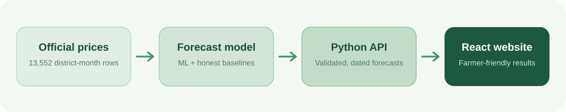

# 🌱 AgriFuture — AI-Powered Crop Price Forecasting

### Smarter Crop Decisions Through Machine Learning

**AgriFuture** is a machine-learning-powered web application that forecasts district-level vegetable wholesale prices across Karnataka, India.

Explore historical agricultural market prices, choose a vegetable and district, and view estimated future monthly wholesale prices with interactive charts, historical error guides, and explanations.

**Built with real agricultural market data — not artificially generated price records.**

[](https://agrifuture-u8ju.onrender.com)
[](https://github.com/harsha-vardhan-c/agrifuture)


**Live Website:** https://agrifuture-u8ju.onrender.com

> **Note:** The free hosting instance may take around a minute to wake up after inactivity.

---

## 📸 Application Screenshots

### Homepage

A responsive landing page introducing AgriFuture and its agricultural price insights.


### Crop and District Selection

Select a vegetable, an eligible Karnataka district, and a future month.


### ML Price Forecast and Visualization

Explore projected wholesale prices, historical trends, forecast ranges, and explanatory insights.


---

## 🎯 Project Overview

Agricultural prices change due to seasonality, supply, demand, market conditions, and other factors.

AgriFuture helps users explore historical prices and provides data-driven estimates of future district-level wholesale prices.

The application returns:

- Estimated monthly wholesale price in **₹ per quintal (100 kg)**.
- Approximate price per kilogram for easier interpretation.
- Historical and projected price trends.
- An illustrative historical-error range.
- Explanations based on historical price patterns.
- Seasonal and festival-calendar context.
- Weather context where available.

**Important:** AgriFuture does not predict the exact price at a particular mandi on a particular day. Its estimates are district-level monthly wholesale price outlooks.

---

## ✨ Key Features

| Feature | Description |
|---|---|
| Crop selection | Choose from crops with eligible historical data |
| District selection | View supported Karnataka districts for each crop |
| Future price forecasting | Estimate monthly wholesale prices |
| Historical analysis | Explore observed agricultural price trends |
| Interactive charts | Compare historical prices and future estimates |
| Forecast error guide | Understand historical prediction uncertainty |
| Explanatory insights | Review seasonality and historical price patterns |
| Weather context | Optional historical and short-term weather information |
| Responsive interface | Works on desktop and mobile browsers |
| REST API | FastAPI backend for forecasts and metadata |

---

## 🛠️ Technology Stack

| Layer | Technologies |
|---|---|
| Frontend | React 19, Vite 6, Tailwind CSS 4, CSS |
| Backend | Python, FastAPI, Uvicorn |
| Machine Learning | Scikit-learn, HistGradientBoostingRegressor |
| Data Processing | Pandas, NumPy |
| Model Storage | Joblib |
| Data Source | AGMARKNET-derived agricultural market reports |
| Weather Context | Open-Meteo |
| Deployment | Render |
| Version Control | Git and GitHub |
| Testing | Python unittest |

---

## 🏗️ System Architecture



### Application Workflow

1. The user opens the React application.
2. The user selects a vegetable, district, and forecast month.
3. React sends the request to the FastAPI backend.
4. The backend validates the selected inputs.
5. The forecasting system loads the trained model and historical data.
6. The selected forecasting method generates a price estimate.
7. The API returns the estimated price, historical information, and explanations.
8. React displays the results using charts and dashboard components.

---

## 📊 Dataset and Data Source

The project uses a cleaned snapshot of agricultural wholesale price reports derived from government AGMARKNET data.

| Dataset Property | Details |
|---|---|
| Geographic coverage | Karnataka, India |
| Data frequency | Monthly district-level records |
| Historical period | October 2021 – September 2026 |
| Cleaned dataset | 13,552 rows |
| Crops with some history | 20 |
| Price unit | Indian rupees per quintal |
| Latest source month | September 2026 |

Crop and district availability varies according to the quality and coverage of historical records.

Two planned crops, generic Pumpkin and Spinach, had no matching source records. Okra historical data ends early and is currently excluded from predictions.

Original captured reports are preserved in compressed form under `data/raw/` for auditing.

For additional details, see [Dataset Documentation](data/README.md).

**Data freshness:** The dataset is a historical snapshot, not a continuously updating live market feed.

---

## 🤖 Machine Learning Approach

AgriFuture uses historical agricultural wholesale prices to generate future monthly estimates.

### Forecasting Methods

The system evaluates three approaches:

1. **HistGradientBoostingRegressor** — a scikit-learn machine learning model.
2. **Last-price baseline** — uses the most recent observed price as the forecast.
3. **Previous-year-same-month baseline** — uses the price from the corresponding month of the previous year.

### Model Selection

Forecasts are evaluated for horizons from 1 to 12 months.

The best-performing method for each horizon is selected using validation data only.

This means the application does not automatically assume that machine learning will outperform simpler forecasting methods.

### Forecasting Workflow

```text
Historical AGMARKNET Data
          |
          v
Data Cleaning and Validation
          |
          v
Monthly District-Level Price Dataset
          |
          v
Feature Engineering
          |
          v
ML Model + Baseline Forecasts
          |
          v
Validation-Based Method Selection
          |
          v
Forecast Generation
          |
          v
FastAPI Prediction Endpoint
          |
          v
React Dashboard and Charts
```

Weather information is provided as contextual information only. It is not used as a training feature in the deployed price model.

---

## 📈 Model Evaluation

The forecasting system was evaluated using historical holdout periods.

### Evaluation Protocol

**Validation period:**
- Training data through September 2024.
- Forecast evaluation from October 2024 to September 2025.

**Test period:**
- Refit using data available through September 2025.
- Evaluate forecasts from October 2025 to September 2026.
- Test observations are not used to choose the winning forecasting method.

### Held-Out Test Results

| Metric | Result |
|---|---|
| Selected-method pooled WAPE | 26.19% |
| Selected-method pooled MAE | ₹598.69/quintal |
| Crop–district–horizon comparisons | 1,808 |
| 12-month HGB WAPE | 22.67% |
| 12-month HGB MAE | ₹535.07/quintal |
| 12-month comparisons | 151 |

The 12-month HGB validation WAPE was 33.72%.

### Understanding the Metrics

**MAE (Mean Absolute Error):** The average absolute difference between predicted and actual prices.

**WAPE (Weighted Absolute Percentage Error):** The total absolute forecast error divided by the total actual value, expressed as a percentage.

These metrics describe historical forecasting performance. They do not guarantee the accuracy of future predictions.

Simple baselines outperform the machine learning model at some horizons, so the application uses validation-selected forecasting methods rather than assuming that a more complex model is always better.

For more information, see [Model Card](docs/MODEL_CARD.md).

---

## 🌐 Live Deployment

AgriFuture is publicly hosted using Render.

### [🚀 Open the Live Application](https://agrifuture-u8ju.onrender.com)

The deployed application uses:

- React/Vite for the frontend.
- FastAPI for the backend.
- Scikit-learn and Joblib for model inference.
- Render for application hosting.
- GitHub for source code and deployment integration.

### Render Configuration

**Runtime:** Python 3

**Build Command:**

```bash
pip install -r requirements.txt && cd frontend && npm ci && npm run build
```

**Start Command:**

```bash
uvicorn backend.app:app --host 0.0.0.0 --port $PORT
```

The frontend is built during deployment, and FastAPI serves the compiled application.

---

## 💻 Run Locally

### Prerequisites

- Python 3.12 recommended for local development.
- Node.js 20 or newer.
- Git.

### 1. Clone the Repository

```bash
git clone https://github.com/harsha-vardhan-c/agrifuture.git
cd agrifuture
```

### 2. Create a Virtual Environment

On Windows:

```powershell
py -3.12 -m venv .venv
```

### 3. Install Python Dependencies

```powershell
.\.venv\Scripts\python.exe -m pip install -r requirements.txt
```

### 4. Build the React Frontend

```powershell
cd frontend
npm ci
npm run build
cd ..
```

### 5. Start FastAPI

```powershell
.\.venv\Scripts\python.exe -m uvicorn backend.app:app --host 127.0.0.1 --port 8000
```

Open:

**http://127.0.0.1:8000**

### Frontend Development Mode

To develop the React interface with hot reloading:

```bash
cd frontend
npm ci
npm run dev
```

The Vite development server runs at:

**http://localhost:5173**

Keep the FastAPI backend running separately on port 8000.

### Run Tests

```powershell
.\.venv\Scripts\python.exe -m unittest discover -s tests -v
```

### Retrain the Model

```powershell
.\.venv\Scripts\python.exe -m backend.train
```

Retraining should only be performed after checking the dataset, environment, and training configuration.

---

## 🔌 API Endpoints

FastAPI provides the following endpoints:

| Method | Endpoint | Description |
|---|---|---|
| GET | `/health` | Check application and model readiness |
| GET | `/api/metadata` | Retrieve supported crops, districts, and months |
| POST | `/api/predict` | Generate a crop price forecast |
| GET | `/api/history/{crop}/{district}` | Retrieve historical prices |
| GET | `/api/weather/live?district=Bengaluru` | Retrieve optional short-term weather context |
| GET | `/docs` | Interactive FastAPI API documentation |

### Example Prediction Request

```json
{
  "crop": "Beans",
  "district": "Bengaluru",
  "month": "2026-12"
}
```

---

## 📁 Project Structure

```text
agrifuture/
|
|-- backend/
|   |-- app.py
|   |-- forecasting.py
|   |-- train.py
|   |-- explanations.py
|   |-- weather.py
|
|-- data/
|   |-- karnataka_prices.csv
|   |-- crop_coverage.csv
|   |-- raw/
|
|-- frontend/
|   |-- src/
|   |-- package.json
|   |-- vite.config.js
|
|-- models/
|   |-- forecast_bundle.joblib
|
|-- reports/
|   |-- backtest.json
|   |-- crop_test_errors.csv
|
|-- screenshots/
|   |-- dashboard.png
|   |-- price-outlook.png
|   |-- forecast-result.png
|
|-- docs/
|   |-- architecture.svg
|   |-- MODEL_CARD.md
|   |-- PROJECT_WALKTHROUGH.md
|   |-- DEPLOYMENT.md
|
|-- scripts/
|-- tests/
|-- requirements.txt
|-- README.md
|-- LICENSE
```

The `screenshots/` directory contains images used in this README.

---

## ⚠️ Project Limitations

AgriFuture is an educational and portfolio forecasting application.

Its limitations include:

- Wholesale agricultural prices are affected by supply, demand, government interventions, crop quality, and other factors that may not be captured in the dataset.
- Forecasts represent district-level monthly estimates, not daily prices for individual markets.
- The historical dataset ends in September 2026.
- Some crop–district combinations have limited or incomplete records.
- Validation and testing currently use one fixed forecast origin each.
- Additional rolling-origin evaluations would improve confidence in model performance.
- Festival-calendar information is contextual, not proof of price causation.
- Forecast ranges are illustrative historical-error guides, not calibrated statistical confidence intervals.
- Weather data covers a limited number of city coordinates and is not used to train the price forecasting model.
- The free hosting instance may sleep during inactivity.

**This application is not a government advisory service or a guarantee of future agricultural prices.**

---

## 📚 Additional Documentation

- [Project Walkthrough](docs/PROJECT_WALKTHROUGH.md)
- [Machine Learning Model Card](docs/MODEL_CARD.md)
- [Dataset Documentation](data/README.md)
- [Deployment Documentation](docs/DEPLOYMENT.md)
- [System Architecture](docs/architecture.svg)

---

## 🔮 Future Improvements

Potential improvements include:

- Automated ingestion of newly published agricultural price records.
- Additional rolling-origin backtesting.
- Broader district and crop coverage.
- More detailed model monitoring.
- Improved forecast uncertainty calibration.
- Performance monitoring for deployed inference.
- Mobile usability and accessibility improvements.

These are planned improvements, not currently implemented features.

---

## 👨‍💻 Author

**Harsha Vardhan**

GitHub: [harsha-vardhan-c](https://github.com/harsha-vardhan-c)

Project: [AgriFuture](https://github.com/harsha-vardhan-c/agrifuture)

Live Demo: [agrifuture-u8ju.onrender.com](https://agrifuture-u8ju.onrender.com)

---

## 📄 License

See the [LICENSE](LICENSE) file for license details.

---

**AgriFuture — Better crop decisions start with better price insights.**

*Built as a machine learning and full-stack development portfolio project.*
